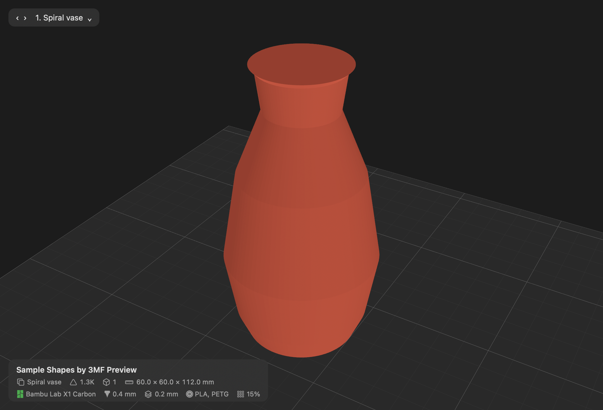
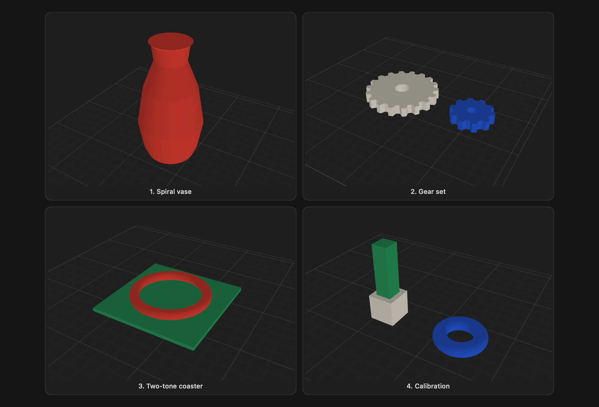
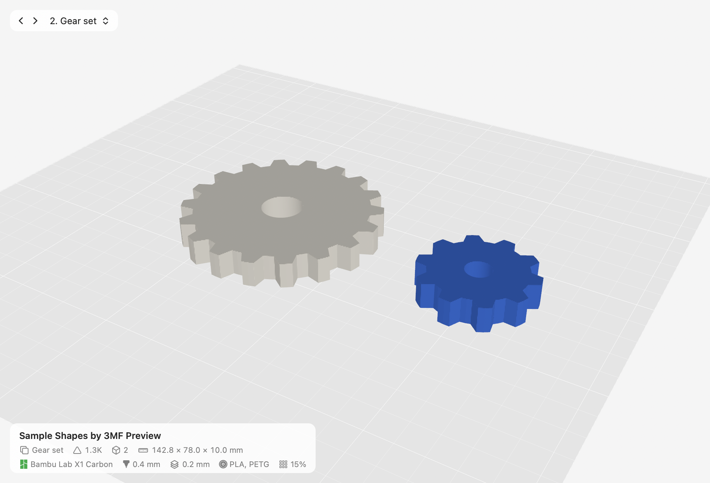
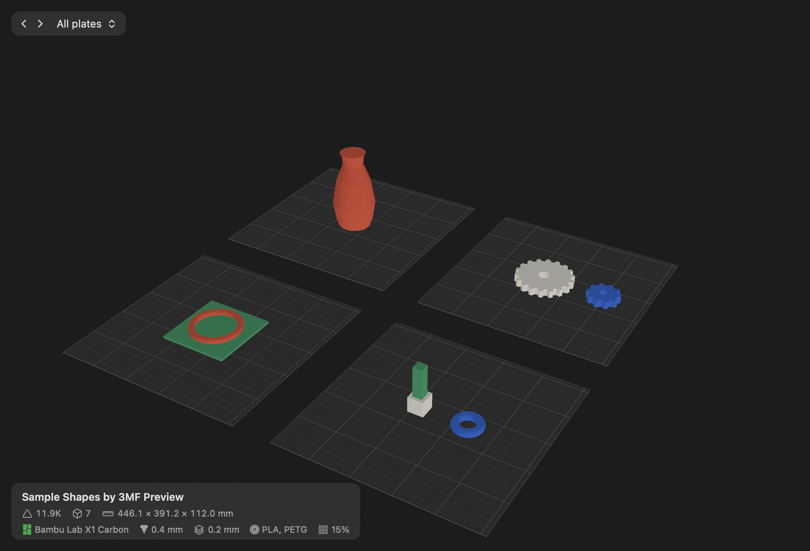

# 3MF Quick Look

A macOS Quick Look extension for **.3mf** 3D-printing projects. You get real 3D renders in Finder thumbnails, and pressing <kbd>Space</kbd> opens an interactive preview that understands Bambu Studio / OrcaSlicer multi-plate projects.



| Grid of plates | Light appearance |
|---|---|
|  |  |

## Features

- **Finder thumbnails:** uses the slicer's embedded preview image when the file has one, and otherwise renders the model.
- **Interactive preview:** orbit, pan and zoom with SceneKit. Each surface is shaded flat, which keeps large meshes (500k+ triangles) quick.
- **Filament colours:** taken from `basematerials` / `colorgroup` and from the extruder → filament colour mapping in Bambu/Orca projects.
- **Multi-plate projects:**
  - a plate dropdown with ‹ › buttons (←/→ also work);
  - "All plates" as the slicer's original layout or as a **grid of close-ups**, switched with the round button in the top-right corner (click a tile to open that plate);
  - the camera re-fits to each plate.
- **Build plate grid:** sized to the printer's bed and laid out exactly like the slicer's plates.
- **Model info panel:** title and designer, triangle count, object count, dimensions, printer (with brand logo), nozzle, layer height, filament types and infill.
- **Appearance:** follows the system, or force light or dark.
- **Settings app:** the host app is a small settings window.



## Supported files

- The 3MF core spec plus the production extension (`p:path` components spread across several model files), including Zip64 packages.
- Bambu Studio and OrcaSlicer metadata (`Metadata/model_settings.config`, `Metadata/project_settings.config`). Other slicers' 3MF files show the full model without plate data.
- Not supported yet: per-triangle paint (`paint_color`), textures, beam lattices.

## Install

### Download

1. Download `ThreeMFPreview.zip` from the [latest release](https://github.com/reesz/3mf-quicklook/releases/latest) and unzip it.
2. Move `ThreeMFPreview.app` to `~/Applications`.
3. The build is signed ad-hoc and not notarized, so remove the quarantine flag:
   ```bash
   xattr -dr com.apple.quarantine ~/Applications/ThreeMFPreview.app
   ```
4. **Open the app once** (macOS won't launch a new app's Quick Look extensions until the app has been opened), then reset Quick Look:
   ```bash
   qlmanage -r
   ```

### Build from source

Requirements: macOS 13+, Xcode, [XcodeGen](https://github.com/yonaskolb/XcodeGen) (`brew install xcodegen`).

```bash
./install.sh
```

The script generates the Xcode project, builds a Release build, copies it to `~/Applications/ThreeMFPreview.app`, registers the extensions, **opens the app once** (macOS won't launch a new app's Quick Look extensions until the app has been opened) and resets the Quick Look cache.

The app is signed ad-hoc ("Sign to Run Locally"), so it's meant for your own Mac. To share a build, sign it with your Developer ID and notarize it.

### Settings

Open **3MF Preview** from `~/Applications`:

| Setting | Default |
|---|---|
| Appearance | System |
| "All plates" view | Original layout |
| Show build plate | Off |
| Show model info | Off |

Settings are stored in the `local.threemfpreview.settings` defaults domain. The sandboxed extensions read that domain through a shared-preference entitlement.

### Troubleshooting

- `pluginkit -mAv | grep threemf` should list both extensions from `~/Applications`.
- If Finder still shows the slicer's icon, run `qlmanage -r && qlmanage -r cache` and reopen the folder.
- `qlmanage -t -x -s 512 -o /tmp file.3mf` tests the thumbnail extension; `qlmanage -p file.3mf` tests the preview.

## Project layout

```
App/            Host app (SwiftUI settings window)
Preview/        Quick Look preview extension (view controller, plate grid, info panel, brand logos)
Thumbnail/      Quick Look thumbnail extension
Shared/         ZIP reader, fast 3MF/XML parser, SceneKit scene builder, settings
Samples/        Generic sample project (procedural shapes)
Tools/          Sample generator + offscreen screenshot renderer
project.yml     XcodeGen spec
```

To regenerate the sample file and the screenshots in `docs/`:

```bash
./Tools/screenshots.sh
```

## Credits

The printer brand glyphs come from [Simple Icons](https://simpleicons.org) (CC0). The logos remain trademarks of their owners and are used only to show which printer a file targets.
